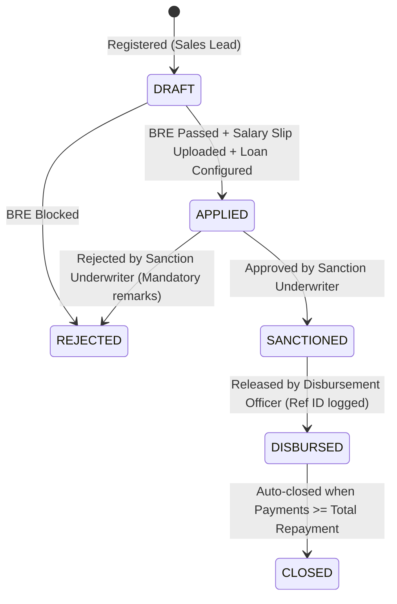

# CredPulse LMS — Loan Management System

[](https://www.typescriptlang.org/)
[](https://nextjs.org/)
[](https://client-mu-one-85.vercel.app)
[](https://mongoosejs.com/)
[](https://tailwindcss.com/)

A full-stack, enterprise-grade **Loan Management System (LMS)** where retail borrowers apply through an eligibility-guarded funnel and internal credit teams manage those loans through their operational lifecycle.

🌐 **Live Frontend Application**: [https://client-mu-one-85.vercel.app](https://client-mu-one-85.vercel.app)  
🚀 **Live Backend API**: [https://server-liart-two-67.vercel.app](https://server-liart-two-67.vercel.app)  
☁️ **Cloud Database**: MongoDB Atlas Production Cluster (AWS Mumbai `AP_SOUTH_1`)

---

## 1. Quick Start Guide

### A. Prerequisites
- **Node.js**: v18+ or v22+
- **MongoDB**: Running locally at `mongodb://127.0.0.1:27017` (or provide custom URI in `server/.env`)

### B. Setup & Database Seeding
```bash
# 1. Install dependencies across backend & frontend
npm run install:all

# 2. Seed database with pre-created accounts & realistic lifecycle data
npm run seed
```

### C. Launch Applications
```bash
# Starts both Backend (Port 5001) and Frontend (Port 3001) concurrently
npm run dev
```

Open **[http://localhost:3001](http://localhost:3001)** in your browser.
*(Port 3001 is used to prevent port conflicts with any services already occupying port 3000).*

---

## 2. Pre-Seeded Test Accounts (1-Click Switcher)

The application includes a **test persona switcher** banner at the top of the interface that allows you to swap roles with **1 click**:

| Role | Email | Password | Access Scope | Pre-seeded Records Available |
| :--- | :--- | :--- | :--- | :--- |
| **👑 Admin** | `admin@lms.local` | `Admin@1234` | Full access across all 4 modules + Analytics | Audit logs, portfolio KPIs, multi-tab switch |
| **🎯 Sales** | `sales@lms.local` | `Sales@1234` | Sales Module only (`/ops/sales`) | 2 pre-application leads at drop-off stages |
| **⚖️ Sanction** | `sanction@lms.local` | `Sanction@1234` | Sanction Module only (`/ops/sanction`) | 1 loan in `APPLIED` status ready for review |
| **💸 Disbursement** | `disburse@lms.local` | `Disburse@1234` | Disbursement Module only (`/ops/disbursement`) | 1 loan in `SANCTIONED` status ready to disburse |
| **💳 Collection** | `collection@lms.local` | `Collection@1234` | Collection Module only (`/ops/collection`) | 1 active `DISBURSED` loan + 1 settled `CLOSED` loan |
| **👤 Borrower** | `borrower@lms.local` | `Borrower@1234` | Borrower Portal only (`/borrower/*`) | Verified applicant with salary slip uploaded |

---

## 3. Platform Architecture & Features

| Capability | Architecture & Implementation |
| :--- | :--- |
| **End-to-End Workflow** | **Closed-loop pipeline**: Borrower Registration &rarr; BRE check (pass & fail scenarios) &rarr; Document upload &rarr; Interactive loan calculator & apply &rarr; Sanction approval/rejection with remarks &rarr; Disbursement with bank reference &rarr; Collection payment with unique UTR &rarr; Automated closure upon zero balance. |
| **Code Quality & TypeScript** | Full-stack TypeScript (`strict: true`), zero magic numbers or strings (domain constants and typed enums), Zod schema validations on client and server, layered architecture (`Controller -> Service -> Model`), clean error handlers. |
| **Deterministic BRE & Loan Math** | **Simple Interest formula**: $SI = \frac{P \cdot R \cdot T}{365 \cdot 100}$ at `12% p.a.` with epsilon decimal rounding; server-authoritative BRE checking strict calendar age (23-50), salary &ge; ₹25,000, PAN regex, and employment verification. |
| **Dual-Layer RBAC** | **Dual-layer enforcement**: JWT middleware checking permissions returning HTTP `401 Unauthorized` and `403 Forbidden` for unauthorized routes; Next.js navigation and page guards hiding unauthorized UI. |
| **UI/UX & Responsiveness** | Modern fintech design using Tailwind CSS, live calculation slider cards, document preview modal for salary slips, status pills, and 1-click test persona switcher. |
| **Audit Logging** | Comprehensive audit trail logging every financial state transition with actor ID, IP address, before/after states, and timestamp. |

---

## 4. Architectural Design Highlights

### Q1: Should BRE live on client, server, or both? Why?
- **Dual-Layered with Server-Authoritative Execution.**
  - **Client-Side**: Gives instant inline feedback (e.g. invalid PAN pattern, under-age warning) as the borrower fills the form, eliminating unnecessary latency and network hops.
  - **Server-Side (Authoritative)**: Crucial for fraud prevention and data integrity. Because client-side code can be bypassed by malicious actors or modified API payloads, the server independently validates every rule and strictly rejects non-compliant applications (`HTTP 422 Unprocessable Entity`).

### Q2: What is the correct PAN regex?
- **Pattern**: `^[A-Z]{5}[0-9]{4}[A-Z]{1}$`
  - Exactly 5 uppercase alphabetical characters (first 3 letters: series, 4th letter: applicant status [P for individual], 5th letter: first letter of applicant surname).
  - Exactly 4 numeric digits (`0001` to `9999`).
  - Exactly 1 uppercase alphabetical check character.

### Q3: What status transitions happen in Sanction? What comes after Disbursement?


### Q4: How do you track outstanding balance and what validations are required on payments?
- **Balance Math**:
  $$\text{Outstanding Balance} = \text{Total Repayment} - \sum(\text{Verified Payments})$$
- **Strict Validations Enforced**:
  1. **UTR Uniqueness**: Enforced via MongoDB unique index on `utrNumber`; rejects duplicates with `HTTP 409 Conflict`.
  2. **Payment Amount Sanity**: Amount must be $> 0$ and $\le \text{Outstanding Balance}$. Overpayments are blocked to prevent financial skew.
  3. **Loan Status Check**: Payments can only be recorded on loans in status `DISBURSED`.
  4. **Auto-Closure Trigger**: Inside the payment service, if `newRemainingBalance <= 0`, status automatically updates to `CLOSED` and `closedAt` timestamp is recorded.

---

## 5. REST API Specifications

### Authentication (`/api/auth`)
- `POST /api/auth/register`: Register new borrower account.
- `POST /api/auth/login`: Authenticate and receive JWT token + user profile.
- `GET /api/auth/me`: Fetch authenticated session profile.

### Borrower Application (`/api/borrower`)
- `POST /api/borrower/eligibility-check`: Run server BRE evaluation on personal details.
- `POST /api/borrower/upload-salary-slip`: Multer document upload (PDF/JPG/PNG &le; 5 MB).
- `GET /api/borrower/calculate`: Live Simple Interest calculation helper.
- `POST /api/borrower/apply`: Submit configured loan request (`APPLIED` status).
- `GET /api/borrower/my-loans`: Fetch borrower's loan facilities and repayment status.

### Operations Dashboard (`/api/ops`)
- **Sales** (`requireRoles(SALES)`):
  - `GET /api/ops/sales/leads`: Fetch pre-application drop-off leads.
- **Sanction** (`requireRoles(SANCTION)`):
  - `GET /api/ops/sanction/queue`: Fetch applied loans queue.
  - `POST /api/ops/sanction/:id/review`: Approve (`SANCTIONED`) or Reject (`REJECTED`) with remarks.
- **Disbursement** (`requireRoles(DISBURSEMENT)`):
  - `GET /api/ops/disbursement/queue`: Fetch approved queue.
  - `POST /api/ops/disbursement/:id/disburse`: Execute capital release (`DISBURSED`).
- **Collection** (`requireRoles(COLLECTION)`):
  - `GET /api/ops/collection/loans`: Fetch active and closed loans portfolio.
  - `POST /api/ops/collection/:id/record-payment`: Record repayment with unique UTR; triggers auto-close if settled.
  - `GET /api/ops/collection/:id/payments`: Retrieve transaction receipts for a loan.
- **Admin** (`requireRoles(ADMIN)`):
  - `GET /api/ops/admin/overview`: Aggregate portfolio metrics, state distribution, and audit log.

### Secure Documents (`/api/files`)
- `GET /api/files/salary-slip/:filename`: Authenticated streaming of salary slips. Salary slips contain borrower PII, so they are **never** served from a public static directory — this route verifies the JWT (via `Authorization` header or `?token=` query, required for `<iframe>`/`` tags) and authorizes privileged ops roles plus the owning borrower only.

---

## 6. End-to-End Operational Lifecycle Walkthrough

1. **Borrower BRE Evaluation**:
   - Navigate to `/borrower/apply`.
   - Test BRE boundary checks (e.g., Age < 23 or Salary < ₹25,000) &rarr; system returns clear underwriting violation reasons.
   - Enter eligible borrower details &rarr; BRE passes and enables document upload.
   - Attach salary slip document &rarr; configure loan amount and tenure using live interest calculation sliders &rarr; submit loan (`APPLIED` status).
2. **Sanction Underwriting Review**:
   - Access Sanction Executive workspace (`/ops/sanction`).
   - Open newly applied loan in queue &rarr; inspect borrower salary slip modal &rarr; approve loan (`SANCTIONED` status).
3. **Fund Disbursement Execution**:
   - Access Disbursement Officer workspace (`/ops/disbursement`).
   - Review sanctioned loan and recipient bank credentials &rarr; release funds with bank transfer reference &rarr; loan transitions to `DISBURSED`.
4. **Collection & Automated Loan Closure**:
   - Access Collection Agent workspace (`/ops/collection`).
   - Locate active loan &rarr; record payment with unique bank UTR.
   - Upon full settlement (remaining balance = 0), the system automatically transitions the loan to `CLOSED`.
5. **RBAC Guard Verification**:
   - Access unauthorized routes (e.g., borrower accessing `/ops/admin`) &rarr; system returns HTTP 403 Forbidden with access restriction alert.
